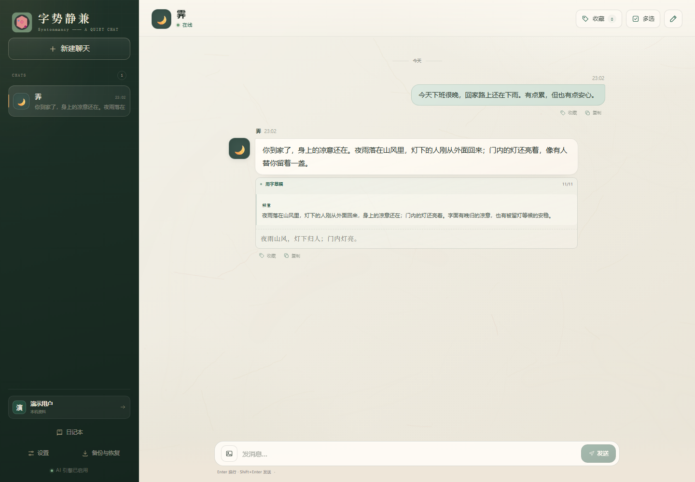
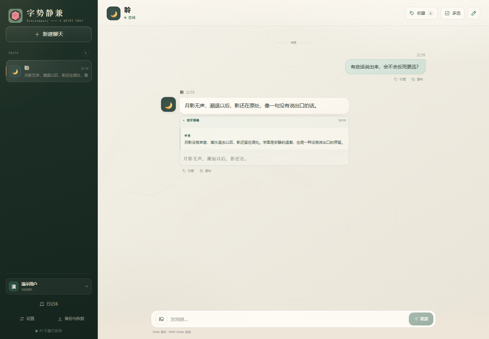

# 字势静兼 / Syntonmancy 2.1.6

**得字解句式跨维聊天平台 · 技术披露与可复现材料**

- 应用版本：**2.1.6**
- 报告定稿：**2026-11-16**
- 应用源文件：`hanzi-oracle.html`
- 应用 SHA-256：`ef21b81c7726ee2c44d0613904b005408d8fff65ce25388b4f90feac135f29cc`
- 论文：CC BY 4.0
- 代码：GPL-3.0-only
- 文档、提示词与示例：Apache-2.0

> 这是 2.1.6 的定稿材料。外部投稿模板里曾出现 `2.1.3` 的示例文件名；本仓库以最终论文与应用的实际版本 **2.1.6** 为准。

## 一句概括

字势静兼不把“长程聊天记忆”作为核心，而是每轮从 3,000 个常用汉字中随机得字，要求模型先用全部得字组成 `word_layer`，再在 **至少 70% 来自本轮字义、最多 30% 自由联想** 的预算内写 `interpretation`，最后把 `interpretation` 转写成可直接发给用户的 `reply`。

聊天界面、用字草稿、日记评论、图片弱参考、备份和本地账户都在单文件 HTML 中实现；桌面端是 Electron 包装，Android 端是 WebView 包装。

## 仓库结构

```text
repo/
  README.md
  LICENSE                          # GPL-3.0-only，代码
  LICENSE-PAPER                    # CC BY 4.0，论文
  LICENSE-APACHE-2.0               # Apache-2.0，文档/提示词/示例
  LICENSING.md                     # 文件级许可证地图
  TECHNICAL-DISCLOSURE.md          # 技术披露摘要
  ARCHITECTURE.md                  # 架构与数据流
  CHECKSUMS.txt                    # 除自身外全部文件的 SHA-256
  CITATION.cff                     # GitHub 引用元数据
  .zenodo.json                     # Zenodo/GitHub 集成元数据
  ZENODO-METADATA.md               # Zenodo 字段建议
  paper/
    字势静兼-技术披露-v2.1.6.pdf
    字势静兼-技术披露-v2.1.6.docx
  code/
    syntonmancy-2.1.6-source.zip
  prompts/
    SYSTEM-PROMPT.md
  examples/
    example-01.json
    example-01.md
    example-01.png
    example-02-bridge-only.json
    example-02-bridge-only.md
    example-02-bridge-only.png
  docs/
    PARAMETER-TABLE.md
```

## 快速开始

### Web 单文件版

从 `code/syntonmancy-2.1.6-source.zip` 解压后，直接用现代浏览器打开 `hanzi-oracle.html`。

首次使用：

1. 注册本机账户。
2. 阅读并确认成年与免责声明。
3. 打开“设置 → 连接 AI 引擎”，选择服务商，填写自己的 API Key。
4. 回到聊天框开始。

应用本身不包含模型额度。第三方 API 费用由用户向对应服务商支付。

### 桌面端

源码在 `code/syntonmancy-2.1.6-source.zip` 的 `desktop/` 中。发布页可另外提供 Electron 构建产物；本仓库以源代码和可复现材料为主。

### Android

源码在 `code/syntonmancy-2.1.6-source.zip` 的 `android-native/` 中，使用 Android WebView 加载本地 `assets/index.html`。

## 示例

### 示例一：有 landing 的普通轮次



- 用户：`今天下班很晚，回家路上还在下雨。有点累，但也有点安心。`
- 得字：山、风、夜、雨、灯、归、人、门
- `word_layer`：`夜雨山风，灯下归人；门内灯亮。`
- `landing`：`你到家了，身上的凉意还在。`
- `reply`：先落地回答，再以“灯还亮着”的意象桥接。

完整 JSON：[`examples/example-01.json`](examples/example-01.json)  
说明：[`examples/example-01.md`](examples/example-01.md)

### 示例二：bridge-only



- 用户：`有些话说出来，会不会反而更远？`
- 得字：月、影、无、声、潮、退
- `landing`：空
- `reply`：只写桥接意象，不硬造一个“是/否”答案。

完整 JSON：[`examples/example-02-bridge-only.json`](examples/example-02-bridge-only.json)  
说明：[`examples/example-02-bridge-only.md`](examples/example-02-bridge-only.md)

> 两张截图是 2.1.6 界面中的**固定示例数据**，用于展示结构，不是某次真实模型调用的逐字截图。示例 JSON 是人工整理的合规样例，模型实际输出会变化。

## 技术披露

- 摘要与边界：[`TECHNICAL-DISCLOSURE.md`](TECHNICAL-DISCLOSURE.md)
- 架构：[`ARCHITECTURE.md`](ARCHITECTURE.md)
- 参数表：[`docs/PARAMETER-TABLE.md`](docs/PARAMETER-TABLE.md)
- 系统提示词：[`prompts/SYSTEM-PROMPT.md`](prompts/SYSTEM-PROMPT.md)

论文 PDF 是排版定稿；论文 DOCX 用于可访问性和后续修订。两者内容一致时，以 PDF 的公开版本为准。

## 校验

`CHECKSUMS.txt` 使用 SHA-256，格式为：

```text
<hash>  <relative-path>
```

校验方法：

```bash
# Linux / macOS
sha256sum -c CHECKSUMS.txt

# Windows PowerShell
Get-Content CHECKSUMS.txt | ForEach-Object {
  $h,$p = $_ -split '  ',2
  $actual = (Get-FileHash -Algorithm SHA256 -LiteralPath $p).Hash.ToLower()
  if ($actual -ne $h) { Write-Error "MISMATCH $p" }
}
```

`CHECKSUMS.txt` 不包含自身。

## 许可证与引用

文件级许可证见 [`LICENSING.md`](LICENSING.md)。建议引用：

```text
字势静兼作者. (2026). 字势静兼 / Syntonmancy 2.1.6:
得字解句式跨维聊天平台（技术披露与可复现材料）.
Zenodo. https://doi.org/10.5281/zenodo.24252070
```

GitHub 仓库地址与 Zenodo DOI 已写入本 README；[`ZENODO-METADATA.md`](ZENODO-METADATA.md) 保留为元数据参考。

## 边界与限制

- 本项目是本地客户端，不提供云端账户、密码找回或云端同步。
- 聊天与日记没有按账户加密；拿到本机硬盘的人仍可能读取数据。
- 应用不验证身份证明；“年满 18 周岁”是用户自证。
- 第三方模型可能产生事实错误、逻辑漏洞或幻觉；输出需用户自行复核。
- “防御串”是 30 位固定完整性常量与艺术设定，不是经验证的安全防护。
- 独立“呈现层编辑 pass”是设计讨论，2.1.6 未实现；仅在 reply 与 word_layer 重复时调用一次 `rewriteReplyOnly`。

## 致谢

感谢 DeepSeek Harness 在实现、调试、报告整理和发布材料上的协助。  
感谢 Qwen 对命名、表述与可读性提出的意见。
