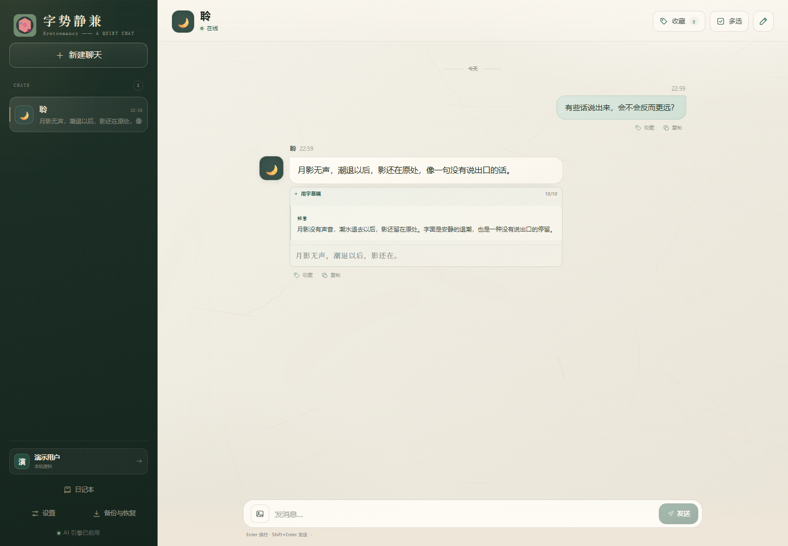

# Example 02 — bridge-only



> The screenshot uses fixed example data in the 2.1.6 interface. It is not a raw output from a named model.

## Input

```text
有些话说出来，会不会反而更远？
```

Drawn characters:

```text
月 影 无 声 潮 退
```

Photos: none.

## Output

```json
{
  "interpretation": "月影没有声音，潮水退去以后，影还留在原处。字面是安静的退潮，也是一种没有说出口的停留。",
  "landing": "",
  "word_layer": "月影无声，潮退以后，影还在。",
  "reply": "月影无声，潮退以后，影还在原处，像一句没有说出口的话。"
}
```

## Why it is valid

- `word_layer` uses every drawn character at least once.
- Borrowed characters: `以`, `后`, `在`, `还` (4 distinct). Six characters were drawn, so the borrow limit is unlimited.
- The question does not have a clear yes/no direction in the drawn characters. The example therefore uses `倾向：不适用` and leaves `landing` empty.
- `reply` is bridge-only: it stays with the tide/moon imagery and does not invent a “yes” or “no”.
- It does not add advice, a question, or a fact outside the word layer.

## Character coverage

| Drawn | Appears in `word_layer` |
| --- | --- |
| 月 | yes |
| 影 | yes (twice) |
| 无 | yes |
| 声 | yes |
| 潮 | yes |
| 退 | yes |

```text
word_layer: 月影无声，潮退以后，影还在。
unique characters in word_layer: 10
borrowed: 以 后 在 还
drawn: 6 -> borrow limit: none
```

## What this example is not

- It is not a claim that the character meanings “prove” the user's situation.
- It is not a claim that bridge-only is always correct for abstract questions. It is the correct shape when the drawn characters do not form a direction.
- The screenshot is a UI demonstration; timestamps and chat list are illustrative.
